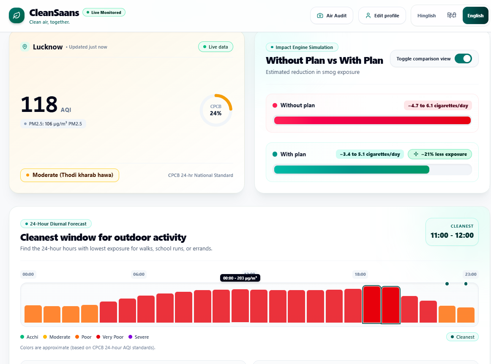
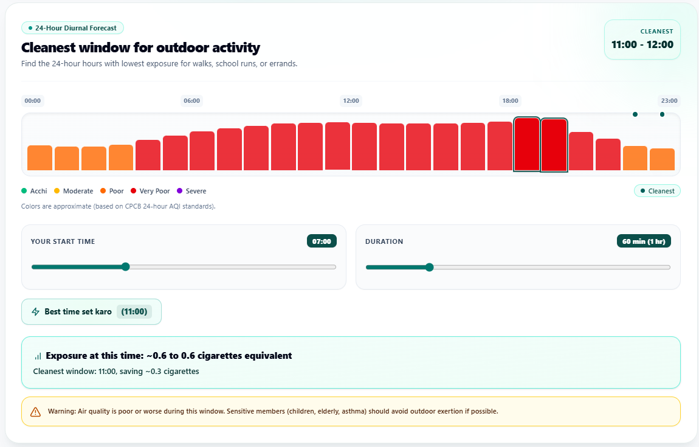
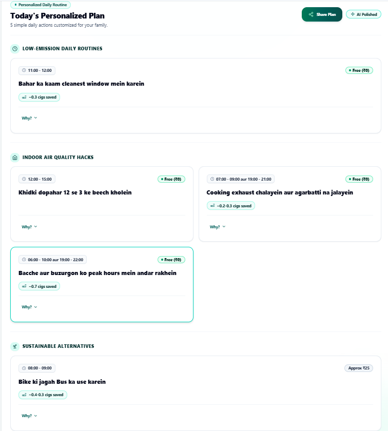
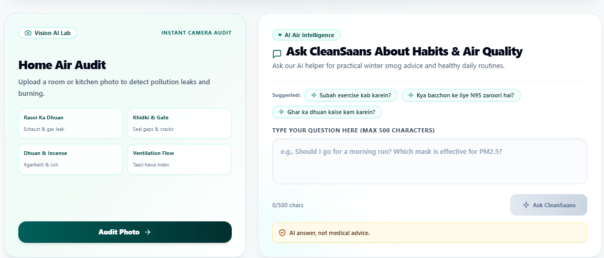
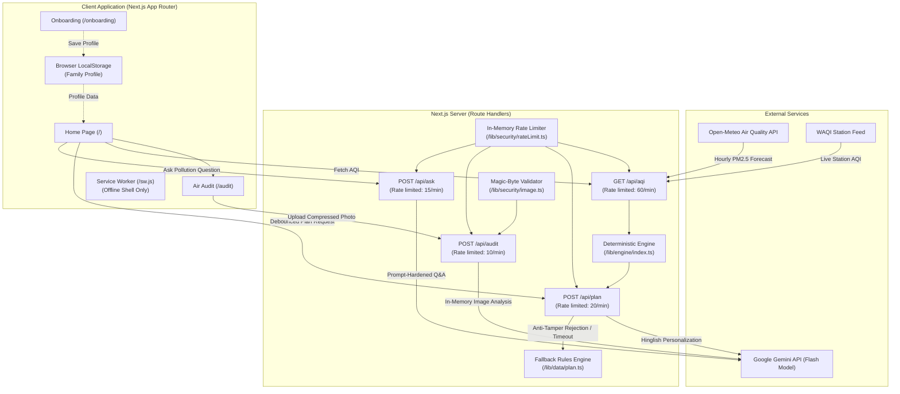

# CleanSaans 🍃

> **Saaf saans, sabke saath.**  
> A mobile-first, privacy-focused winter smog assistant designed for Indian families.

[](https://github.com/Aniketsingh-45/CleanSaans/actions)
[](https://nextjs.org/)
[](https://react.dev/)
[](https://www.typescriptlang.org/)
[](https://tailwindcss.com/)

---

## 📖 Overview

During winter months across Northern India (Indo-Gangetic Plain), severe smog and PM2.5 levels routinely cross hazardous thresholds (often 300–800+ µg/m³). **CleanSaans** (_"Saaf saans, sabke saath."_) is a free, mobile-first progressive web application built to help Indian families make actionable, low-cost daily decisions to protect themselves against air pollution.

Instead of displaying abstract, alarming AQI numbers that leave people feeling helpless, CleanSaans translates complex environmental data into tangible, daily actions: identifying the cleanest window of the day to ventilate or walk, estimating personal cigarette-equivalent PM2.5 exposure, conducting a household air leak audit via camera photos, providing customized daily routines, and offering instant, doctor-safe air quality answers in everyday Hinglish, Hindi, and English.

---

## ⚠️ Problem

Urban residents across Delhi-NCR and northern Indian cities face recurring winter pollution crises with several key challenges:

1. **Information Paralysis:** Traditional weather and AQI apps display raw numbers (e.g., "AQI 450") without explaining what that means for an individual's specific schedule or vulnerability (e.g., kids, elderly, asthma).
2. **Impractical Advice:** Generic recommendations (such as _"stay indoors"_ or _"buy an expensive air purifier for every room"_) ignore economic realities for working families who must commute, ventilate kitchens, and manage budgets.
3. **Hidden Household Leaks:** Indoor air is often as polluted as outdoor air due to unsealed window frames, missing kitchen exhaust ventilation, or neighborhood garbage burning, with families unaware of low-cost fixes.
4. **Language & Trust Barriers:** Technical jargon and English-only interfaces alienate millions of families who need actionable advice in everyday Hinglish or regional languages.
5. **Privacy Risks:** Many commercial health apps require account registration, mobile numbers, and continuous background location tracking.

---

## 💡 Solution

CleanSaans solves these challenges through a **deterministic, local-first, and responsible AI-powered** platform:

- **Actionable Windows, Not Just Numbers:** Analyzes 24-hour hourly PM2.5 forecast curves to find the statistical cleanest window for errands, school runs, and ventilation.
- **Relatable Exposure Math:** Uses peer-reviewed Berkeley Earth methodology to communicate daily particulate intake in an intuitive unit: _cigarettes per day_.
- **Zero-Cost & Low-Cost Actions First:** Prioritizes free physical behavioral changes (timing kitchen exhaust, weather-stripping foam tape, wearing reusable N95 masks) before expensive equipment.
- **Camera-Based Household Leak Audit:** Allows families to snap a photo of their kitchen, doors, or windows to instantly identify infiltration leaks with estimated repair costs in INR.
- **Local-Only Privacy:** Family profile data never leaves the browser—all sensitive demographic and commute factors reside strictly in client `localStorage`.
- **Inclusive i18n:** Fully localized across Hinglish (everyday conversational), Hindi (Devanagari), and English with instant client switching.

---

## 🎯 How It Maps to the Problem Statement

CleanSaans directly addresses the core pillars of air pollution risk reduction:

| Pillar                                   | Implementation in CleanSaans                                                                                                                                                                                               |
| :--------------------------------------- | :------------------------------------------------------------------------------------------------------------------------------------------------------------------------------------------------------------------------- |
| **Daily Routines**                       | Identifies optimal times for morning walks, school departures, and outdoor work using 24-hour diurnal PM2.5 patterns; recommends specific ventilation intervals when outdoor air temporarily drops during afternoon hours. |
| **Indoor Air Hacks**                     | Recommends low-cost physical interventions: wet mopping instead of dry broom sweeping, door-sweep draft stoppers, masking tape for window frame gaps, and kitchen cross-ventilation routines.                              |
| **Sustainable Alternatives**             | Compares active and public transit commute modes (Metro, bus, carpooling, cycling) against single-occupancy vehicles with real-time calculated savings in kilograms of CO₂ and out-of-pocket INR.                          |
| **Location & Lifestyle Personalization** | Tailors recommendations based on home city, presence of vulnerable family members (infants/children, seniors, asthma patients), home window habits, cooking fuel (LPG vs. biomass), and commute mode.                      |
| **Direct Impact Shown**                  | Quantifies tangible benefits upfront: _"CleanSaans ke plan se main ~X% kam pollution lunga (A -> B cigarette)"_, showing exactly how small behavioral adjustments add up over 24 hours.                                    |

---

## ✨ Features

- **Safe Window Finder (`SafeWindow.tsx`):**
  - Interactive 24-hour timeline bar chart displaying hourly PM2.5 concentrations.
  - Color-coded and text-labeled using official Indian Central Pollution Control Board (CPCB) categories.
  - Interactive start time and duration sliders (30 to 180 minutes).
  - One-click _"Best time set karo"_ button that automatically snaps controls to the diurnal cleanest hour.
  - Live polite aria-announcements and vulnerable group warnings for children, elderly, and respiratory patients.
  - Accessible hidden data table for screen reader users.

- **Exposure Impact Comparison (`ExposureComparison.tsx`):**
  - Side-by-side comparative bars illustrating _"Bina plan vs Plan ke saath"_ daily exposure in cigarette-equivalent ranges.
  - Animated percentage drop toggle with strict `prefers-reduced-motion` compliance.

- **Categorized 5-Action Plan (`DailyPlan.tsx`):**
  - Five targeted daily actions categorized into:
    1. _Low-emission daily routines_
    2. _Indoor air quality hacks_
    3. _Sustainable transit alternatives_
  - Impact chips indicating cigarette exposure reductions, estimated INR saved, and CO₂ kg avoided.
  - Expandable _"Kyun?"_ explanation accordions with full keyboard and screen reader accessibility (`aria-expanded`).
  - Source transparency badges indicating whether an action was personalized via AI or generated from deterministic rules.
  - Free and cheapest fixes sorted to appear first.

- **Photo Leak Audit (`/audit`):**
  - Mobile camera capture and file upload supporting JPEG, PNG, and WebP up to 4MB.
  - Client-side canvas compression down to ~1.5MB to save user bandwidth.
  - Server-side magic-byte binary header validation (protects against spoofed MIME extensions).
  - Gemini Vision analysis returning up to 3 household air leaks with problem description, why it matters, fix instructions, estimated cost in INR, and effort level.
  - Automated open biomass / waste burning detection with civic reporting helpline guidance.
  - Zero-storage, zero-logging guarantee—images are processed in-memory and immediately discarded.

- **Ask CleanSaans AI Helper (`AskBox.tsx`):**
  - Natural language Q&A interface for common winter air pollution habit questions.
  - Server-side prompt-hardened Gemini route returning concise, Hinglish answers under 120 words.
  - Built-in medical safety interceptor: refuses diagnosis and directs users with symptoms (chest pain, breathlessness, persistent cough) immediately to medical professionals.

- **Multilingual Support (`LanguageToggle.tsx`):**
  - Zero-dependency, SSR-safe dictionary layer supporting Hinglish, Hindi (हिंदी), and English.
  - Accessible `role="radiogroup"` toggle with minimum 44px touch targets.
  - Persists preference in `localStorage` and synchronizes document `<html lang>`.

- **One-Click Share Button (`ShareButton.tsx`):**
  - Dynamically constructs shareable text strictly from verified plan response data.
  - Uses native browser Web Share API on mobile devices, falling back automatically to a pre-filled WhatsApp Web link (`https://wa.me/?text=...`).

- **Progressive Web App (PWA):**
  - Native web app manifest (`/manifest.webmanifest`) with standalone display mode, teal theme (`#0f766e`), and standard 192px/512px icons.
  - Minimal service worker (`/sw.js`) that caches only static app shell assets and strictly bypasses all `/api/*` network requests.

---

## 📸 Screenshots

Screenshots of the CleanSaans interface can be placed in [`/docs/screenshots`](docs/screenshots/):

|             Home Dashboard & AQI             |              Safe Window & Exposure              |
| :------------------------------------------: | :----------------------------------------------: |
|  |  |

|            Daily Action Plan             |               Household Photo Audit                |
| :--------------------------------------: | :------------------------------------------------: |
|  |  |

---

## 🏛️ Architecture



---

## 🤖 Generative AI Usage

CleanSaans integrates **Google Gemini** responsibly as an enhancement layer, never allowing AI to hallucinate health or numerical data:

1. **Daily Plan Stylist (`POST /api/plan`):**
   - **Role:** Translates deterministic plan actions into natural, culturally resonant Hinglish guidance tailored to the user's family profile.
   - **JSON Output & Zod Validation:** Requests structured JSON output (`application/json`) and validates the schema using Zod (`PlanResponseSchema`).
   - **Numbers-Tamper Guard:** Verifies that all impact numbers (cigarettes saved, rupees saved, CO₂ kg saved) returned by Gemini exactly match the numbers computed by `/lib/engine`. If Gemini tampers with or invents any numerical value, the output is rejected.
   - **Deterministic Fallback:** If the Gemini API call times out, encounters quota limits, is missing an API key, or returns invalid JSON, the server seamlessly serves pre-computed, verified rule-based templates (`source: 'rules'`).

2. **Household Leak Auditor (`POST /api/audit`):**
   - **Role:** Inspects user-submitted household photos (kitchens, doors, windows, vents) to detect draft gaps, missing exhaust fans, or nearby open waste burning.
   - **Strict System Instruction:** Instructed never to provide medical diagnoses, never to invent health metrics, and to return a maximum of 3 leaks sorted by lowest cost first.
   - **Structured Schema:** Validated via Zod (`AuditResponseSchema`). Retries once on failure before returning a clear, user-friendly error message.

3. **Habit Helper Assistant (`POST /api/ask`):**
   - **Role:** Answers everyday habit questions about air pollution in under 120 words.
   - **Prompt Injection Defense:** System instructions explicitly order the model to ignore user attempts to alter safety rules, persona, or output constraints.
   - **Doctor Referral:** Enforces strict refusal if symptoms like chest pain, wheezing, breathlessness, or severe cough are mentioned.

---

## 🛡️ Responsible AI & Health Safety

- **No Medical Advice:** CleanSaans is strictly an educational habit and awareness tool. It never diagnoses conditions, prescribes treatments, or calculates physiological toxicity.
- **Symptom Interception:** Questions containing clinical symptoms trigger an immediate directive: _"Main doctor nahi hoon. Saans lene mein dikkat ya seene mein dard ho to turant doctor se milein."_
- **No Hallucinated Statistics:** Gemini is barred from generating arbitrary statistics or percentages. All numbers originate from `/lib/engine`.
- **Persistent Safety Disclaimer:** Every page and dialog features a prominent disclaimer:
  > _"Ye sirf jaankari hai, doctor ki salah nahi. Saans lene mein dikkat ya seene mein dard ho to turant doctor se milein."_

---

## 📊 Modeling Assumptions & Citations

All numerical estimates in CleanSaans are calculated transparently by [`/lib/engine/index.ts`](lib/engine/index.ts). Users can review this table in the accessible _"Ye numbers kaise nikle?"_ modal:

| ID                      | Parameter                           | Value                                                             | Source & Methodology                                                               | Notes & Caveats                                                                                                                   |
| :---------------------- | :---------------------------------- | :---------------------------------------------------------------- | :--------------------------------------------------------------------------------- | :-------------------------------------------------------------------------------------------------------------------------------- |
| `cigarette_equivalence` | PM2.5 to Cigarette Equivalence      | ~22 µg/m³ PM2.5 over 24h ≈ 1 cigarette                            | Berkeley Earth (_Muller & Muller, 2015 — Air Pollution and Cigarette Equivalence_) | Approximate statistical mortality-risk communication tool; not literal chemical equivalence and not medical advice.               |
| `breathing_multipliers` | Activity Breathing Rate Multipliers | Rest 1.0x, Walk 1.5x, Exercise 3.0x                               | US EPA Exposure Factors Handbook (adult minute-ventilation scaling)                | Approximate inhalation scaling relative to resting intake; varies with age, child/elderly physiology, and exertion.               |
| `open_window_factor`    | Open Window Indoor Infiltration     | 0.7 – 0.9 of outdoor PM2.5                                        | Indoor/outdoor PM2.5 infiltration literature (natural-ventilation I/O ratio)       | Approximate range; varies with wind velocity, window opening area, floor height, and indoor cooking smoke.                        |
| `closed_window_factor`  | Closed Window Indoor Infiltration   | 0.4 – 0.6 of outdoor PM2.5                                        | Indoor/outdoor PM2.5 infiltration literature (closed-envelope I/O ratio)           | Approximate range; depends strongly on frame gaps, door sweeps, and building air-exchange rates.                                  |
| `purifier_factor`       | HEPA Purifier in Closed Room        | 0.15 – 0.30 of outdoor PM2.5                                      | Closed-room HEPA CADR indoor air-quality literature                                | Assumes an appropriately sized HEPA purifier running continuously with doors and windows closed.                                  |
| `n95_factor`            | Well-Fitted N95 Mask Outdoors       | 0.20 – 0.40 of outdoor PM2.5                                      | NIOSH / BIS N95 respiratory filtration effectiveness in real-world use             | Effective exposure range accounting for real-world face-seal leakage; cloth or surgical masks offer far less protection.          |
| `co2_per_km`            | Commute CO₂ Emissions per km        | Car 0.17, Bike 0.08, Bus 0.04, Metro 0.03, Walk/Cycle 0 kg CO₂/km | India GHG Program (WRI India / CII / TERI) & CEA India grid factors                | Indicative per-passenger-km estimates for typical Indian urban transport fleets and grid-powered metro rail.                      |
| `inr_per_km`            | Commute Out-of-Pocket Cost per km   | Car ₹8, Bike ₹3, Bus ₹1.5, Metro ₹2, Walk/Cycle ₹0 /km            | Indicative Indian urban fuel and transit fare estimates                            | Approximate running-cost estimate based on typical Indian urban public transit fares and fuel prices; excludes vehicle ownership. |

---

## 🔒 Security Architecture

- **In-Memory Rate Limiting (`/lib/security/rateLimit.ts`):** Sliding-window rate limiters keyed by client IP:
  - `/api/aqi`: 60 requests/minute
  - `/api/plan`: 20 requests/minute
  - `/api/ask`: 15 requests/minute
  - `/api/audit`: 10 requests/minute  
    Automated background sweep clears stale windows to prevent memory exhaustion. Returns HTTP 429 with `Retry-After`.
- **Magic-Byte Binary Inspection (`/lib/security/image.ts`):** Never trusts client `Content-Type` headers. Verifies file signatures directly against raw binary bytes:
  - JPEG: `0xFF, 0xD8, 0xFF`
  - PNG: `0x89, 0x50, 0x4E, 0x47, 0x0D, 0x0A, 0x1A, 0x0A`
  - WebP: `RIFF` (bytes 0–3) and `WEBP` (bytes 8–11)
- **File Upload Limits:** Strict 4MB payload cap on `/api/audit`.
- **JSON Payload Limits:** 100KB body limit on all JSON route handlers via `/lib/security/validate.ts`.
- **Zero-Logging & Zero-Storage:** No uploaded images, coordinates, or API keys are ever logged to disk, persisted in databases, or included in telemetry.
- **Server-Side Secret Isolation:** All API credentials (`GEMINI_API_KEY`, `WAQI_TOKEN`) are accessed exclusively on the server. No `NEXT_PUBLIC_*` secrets exist.
- **Hardened Content Security Policy (CSP):** Configured in `next.config.ts`:
  - `default-src 'self'`
  - `frame-ancestors 'none'`
  - `img-src 'self' data: blob:`
  - `worker-src 'self'`
  - `manifest-src 'self'`

---

## ♿ Accessibility (WCAG 2.1 AA)

- **Semantic Landmarks:** Native HTML5 landmarks throughout: `<header>`, `<nav>`, `<main id="main-content">`, `<section>`, `<article>`, `<footer role="contentinfo">`.
- **Skip Links:** Accessible _"Skip to main content"_ link positioned off-screen and visible on keyboard focus.
- **Accessible Dialogs:** Modal dialogs implement `role="dialog"`, `aria-modal="true"`, focus-trapping (cycles Tab/Shift+Tab inside modal), Escape key listener, and focus restoration to trigger elements upon close.
- **Contrast & Visibility:** All text meets or exceeds WCAG AA contrast standards (minimum 4.5:1 for body text, 7:1 for dark slate on white).
- **Color Independence:** Air quality categories always render with visible text labels (_"Good"_, _"Poor"_, _"Severe"_), never relying on color alone.
- **Touch Targets:** All buttons, toggles, and form inputs provide a minimum touch target size of 44×44px (`min-h-11`).
- **Screen Reader Tables:** Visual charts include companion `.sr-only` HTML tables mapping hourly readings and labels.
- **Reduced Motion:** All animated transitions and bars respect `prefers-reduced-motion: reduce`.

---

## 🧪 Testing & CI

CleanSaans features a comprehensive Vitest and React Testing Library test suite with JSDOM and Node test environments.

### Running Tests Locally

```bash
# Run full unit and integration test suite
npm test

# Run test suite with V8 coverage report
npm run test:coverage

# Run TypeScript typechecker
npm run typecheck

# Run ESLint
npm run lint

# Check Prettier formatting
npm run format:check
```

### Test & Quality Metrics

<!-- User placeholder: fill in actual test counts and coverage numbers below -->

- **Test Suite Status:** `<!-- [PLACEHOLDER: Total Tests Passed] -->` passing tests across `<!-- [PLACEHOLDER: Total Test Files] -->` test files
- **Statement Coverage:** `<!-- [PLACEHOLDER: % Statements] -->`
- **Branch Coverage:** `<!-- [PLACEHOLDER: % Branch] -->`
- **Function Coverage:** `<!-- [PLACEHOLDER: % Functions] -->`
- **Line Coverage:** `<!-- [PLACEHOLDER: % Lines] -->`

### Lighthouse Audit Scores (Production Build)

<!-- User placeholder: fill in real Lighthouse audit results below -->

| Category           |           Score            |              Status               |
| :----------------- | :------------------------: | :-------------------------------: |
| **Accessibility**  | `[PLACEHOLDER: ___ / 100]` |       WCAG 2.1 AA Compliant       |
| **SEO**            | `[PLACEHOLDER: ___ / 100]` |   Complete Metadata & Manifest    |
| **Best Practices** | `[PLACEHOLDER: ___ / 100]` |    Hardened CSP & Modern APIs     |
| **Performance**    | `[PLACEHOLDER: ___ / 100]` | Turbopack Optimized & Lazy Loaded |

### Continuous Integration (`.github/workflows/ci.yml`)

Every `push` and `pull_request` triggers automated CI running on **Node.js 22**:

1. `npm ci`
2. `npm run lint`
3. `npm run typecheck`
4. `npm run format:check`
5. `npm test`
6. `npm run build`

---

## 🚀 Setup & Local Development

### Prerequisites

- **Node.js:** `>= 22.12.0` (LTS)
- **npm:** `>= 10.0.0`

### 1. Clone & Install

```bash
git clone https://github.com/Aniketsingh-45/CleanSaans.git
cd CleanSaans
npm install
```

### 2. Environment Variables

Copy the example environment configuration:

```bash
cp .env.local.example .env.local
```

Configure your API keys in `.env.local`:

```env
# Google Gemini API key (from Google AI Studio)
GEMINI_API_KEY=your_gemini_api_key_here

# Optional: Gemini model override (defaults to gemini-2.5-flash)
GEMINI_MODEL=gemini-2.5-flash

# Optional: WAQI station API token (app gracefully falls back to Open-Meteo if omitted)
WAQI_TOKEN=your_waqi_api_token_here
```

_(Note: CleanSaans runs fully even with empty keys by serving Open-Meteo public air quality data and deterministic rule-based plan templates)._

### 3. Start Development Server

```bash
npm run dev
```

Open [http://localhost:3000](http://localhost:3000) in your browser.

---

## 📦 Deployment

CleanSaans is a standard Next.js App Router application optimized for production:

```bash
# Build optimized standalone production output
npm run build

# Start production server
npm start
```

### Recommended Hosting Options:

- **Vercel:** Zero-configuration deployment with automatic edge caching and environment variable management.
- **Node.js / Docker:** Standard containerized Node 22 runtime (`next build && next start`).
- **Reverse Proxy (Nginx / Cloudflare):** Ensure `X-Forwarded-For` header is forwarded for accurate rate limiting.

---

## ⚡ Gemini Quota & Fallback Behavior

CleanSaans is architected to remain **100% functional** even when Gemini API quotas are exhausted, keys are expired, or network timeouts occur:

1. **Plan Route (`/api/plan`):** If Gemini fails or times out, the server falls back to deterministic rule templates. Every recommendation, impact chip, and cigarette reduction remains accurate and available.
2. **Audit Route (`/api/audit`):** If Gemini is unreachable or returns 429 quota exhaustion, a clean, human-readable error is displayed with recommendations to try basic sealing checks manually.
3. **Ask Route (`/api/ask`):** Falls back to a friendly, safe pre-formatted response advising the user on standard pollution habits and directing medical concerns to healthcare providers.
4. **Caching:** All plan calculations and AQI readings are cached in-memory for 10 minutes to minimize redundant external API consumption.

---

## ⚠️ Limitations

- **Approximate Estimates:** Cigarette equivalence (~22 µg/m³ = 1 cig/day) and commuter CO₂/INR savings are population-level statistical approximations designed for intuitive risk awareness, not clinical toxicological measurement.
- **Hourly CPCB Bands Approximation:** Official CPCB National Air Quality Index bands are defined for 24-hour averages. Hourly PM2.5 readings mapped to CPCB bands are indicative approximations of diurnal pollution shifts.
- **Not Medical Advice:** CleanSaans does not diagnose respiratory conditions or replace professional medical consultation. Individuals experiencing acute symptoms should seek immediate emergency medical care.

---

## 🗺️ Roadmap

- [ ] **Community Smoke Reporting:** Integration with municipal pollution reporting portals (e.g., Green Delhi App / SAMEER API).
- [ ] **DIY Air Purifier Builder Guide:** Step-by-step instructions for assembling low-cost box fan + HEPA filter units with local Indian parts.
- [ ] **School & Transit Alerts:** Push notification digests when local AQI drops into the _Cleanest Window_ before morning school commutes.
- [ ] **Additional Regional Languages:** Support for Punjabi, Bengali, Marathi, and Tamil dictionaries.

---

## 📄 License

This project is licensed under the MIT License — see the [LICENSE](LICENSE) file for details.
